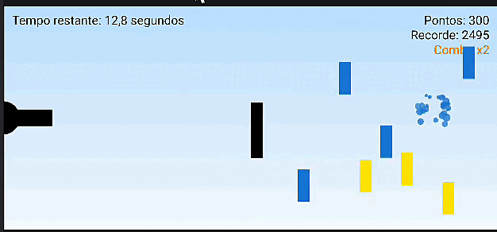
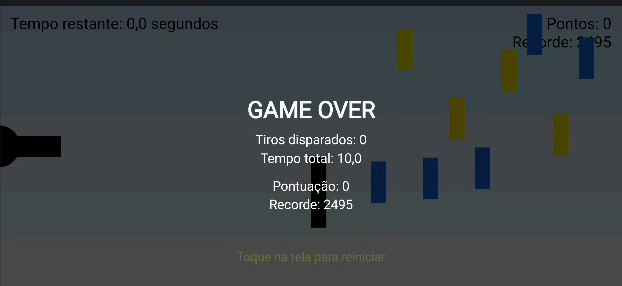

# Cannon Game

Aplicativo Android do jogo Cannon Game, desenvolvido na disciplina de Programação III do curso de Sistemas de Informação da Universidade do Estado de Minas Gerais (UEMG), Unidade Passos. O projeto é baseado no Capítulo 6 (Cannon Game App) do livro *Android 6 for Programmers: An App-Driven Approach*, 3ª edição, de Paul Deitel, Harvey Deitel e Alexander Wald.

## Autores

- Alessandro Moreira Cecilio
- João Luis Pedrosa Teles

## Resumo

Este trabalho apresenta a implementação de um jogo 2D para a plataforma Android no qual o jogador controla um canhão fixo na borda esquerda da tela e deve destruir nove alvos móveis dentro de um tempo limitado, evitando um bloqueador que se move continuamente. A aplicação utiliza `SurfaceView` com um laço de jogo (game loop) executado em thread dedicada, renderização com `Canvas` e `Paint`, tratamento de eventos de toque, efeitos sonoros e modo imersivo. Além do escopo do capítulo de referência, o projeto incorpora um sistema de pontuação com combo, ranking local persistente, sistema de partículas, trilha sonora, modo noturno e localização em dois idiomas.

## Objetivos

### Objetivo geral

Aplicar, em um projeto completo, os fundamentos de desenvolvimento de jogos 2D para Android estudados no Capítulo 6 do material de referência.

### Objetivos específicos

- Implementar gráficos 2D com `Canvas` e `Paint`.
- Implementar animação quadro a quadro baseada no tempo decorrido entre atualizações.
- Construir um game loop em thread própria sobre `SurfaceView` e `SurfaceHolder`.
- Tratar eventos de toque para mirar e disparar o canhão.
- Reproduzir efeitos sonoros e trilha sonora com `SoundPool` e `MediaPlayer`.
- Gerenciar corretamente o ciclo de vida da aplicação, garantindo o encerramento da thread e a liberação de recursos.
- Adaptar o código do livro às APIs atuais do Android (AndroidX e `WindowInsetsController`).

## Descrição do jogo

O canhão está posicionado no centro da borda esquerda da tela. O jogador toca ou arrasta o dedo sobre a tela para apontar o cano na direção do toque e disparar. Apenas uma bala pode estar em cena por vez.

O objetivo é destruir os nove alvos antes que o cronômetro chegue a zero. O desempenho do jogador altera o tempo disponível:

- cada alvo atingido adiciona 3 segundos ao cronômetro;
- a colisão com o bloqueador (barra escura) desconta 2 segundos e inverte a direção horizontal da bala.

Ao final da partida, a tela exibe o resultado (vitória ou derrota), o número de tiros disparados, o tempo total, a pontuação obtida e o recorde. Um toque na tela inicia nova partida.

### Parâmetros do jogo

| Parâmetro | Valor |
|---|---|
| Tempo inicial | 10 s |
| Quantidade de alvos | 9 |
| Recompensa por alvo atingido | +3 s |
| Penalidade por colisão com o bloqueador | -2 s |
| Aumento de velocidade dos alvos restantes | +10% a cada alvo destruído |
| Pontos base por alvo | 100 |
| Multiplicador máximo de combo | x5 |
| Bônus de vitória | 10 pontos por segundo restante |
| Taxa de atualização | aproximadamente 60 quadros por segundo |
| Tamanho do ranking local | 5 pontuações |

### Controles

| Ação | Gesto |
|---|---|
| Apontar e disparar | Toque ou arraste com um dedo |
| Alternar modo dia/noturno | Toque adicional com um segundo dedo durante a partida |
| Reiniciar após o fim da partida | Toque simples na tela |

## Funcionalidades

- Canhão com mira por toque, bala, nove alvos móveis, bloqueador móvel, cronômetro, condições de vitória e derrota.
- Detecção de colisões entre bala e alvos e entre bala e bloqueador, com recompensa ou penalidade de tempo.
- Efeitos sonoros para disparo, acerto em alvo e acerto no bloqueador.
- Orientação paisagem fixa, tela cheia e modo imersivo.
- Tratamento do ciclo de vida: a thread do jogo é encerrada ao pausar a aplicação e ao destruir a `Surface`, e os recursos de áudio são liberados na destruição do fragmento.
- Interface localizada em inglês (padrão) e português do Brasil.

## Funcionalidades adicionais

- **Pontuação com combo:** cada alvo vale 100 pontos multiplicados pelo combo corrente (limitado a x5). O combo é zerado quando a bala sai da tela sem acertar ou colide com o bloqueador. Na vitória, o tempo restante é convertido em pontos adicionais.
- **Ranking local:** as cinco melhores pontuações são persistidas com `SharedPreferences` (classe `HighScoreStore`), e o recorde é exibido durante a partida e na tela final.
- **Efeitos visuais:** explosão de partículas nos acertos (`ParticleSystem`), fundo em degradê, aparecimento gradual (fade-in) e pulsação dos alvos, oscilação senoidal horizontal dos alvos e modo noturno com cores alternativas.
- **Áudio complementar:** jingles de vitória e derrota e trilha sonora em loop reproduzida com `MediaPlayer`, pausada e liberada conforme o ciclo de vida.
- Ícone de aplicativo próprio (adaptive icon).

## Arquitetura

O código-fonte está organizado no pacote `com.deitel.cannongame`, com a seguinte distribuição de responsabilidades:

| Classe | Responsabilidade |
|---|---|
| `MainActivity` | Activity única da aplicação, responsável por exibir o fragmento principal. |
| `MainActivityFragment` | Cria o `CannonView`, repassa os eventos de ciclo de vida (`onPause`, `onResume`, `onDestroy`) e configura o controle de volume. |
| `CannonView` | Componente central. Estende `SurfaceView`, implementa `SurfaceHolder.Callback` e concentra o game loop, a detecção de colisões, o tratamento de toque, o áudio, a pontuação e a renderização. |
| `GameElement` | Classe base dos elementos retangulares do jogo (posição, velocidade vertical, desenho e som associado). |
| `Cannon` | Representa o canhão, calcula o ângulo do cano e dispara a bala. |
| `Cannonball` | Projétil com velocidades horizontal e vertical e controle de saída da tela. |
| `Target` | Alvo com movimento vertical, oscilação senoidal horizontal, fade-in, pulsação e cor própria no modo noturno. |
| `Blocker` | Obstáculo móvel que penaliza o jogador e rebate a bala. |
| `ParticleSystem` | Gerencia as partículas das explosões, com movimento radial, atrito e desvanecimento. |
| `HighScoreStore` | Persistência e consulta do ranking local. |
| `GameResultDialogFragment` | `DialogFragment` de resultado, implementado como classe própria conforme descrito nas adaptações. |

### Estrutura de diretórios

```
CannonGame/
├── app/
│   └── src/main/
│       ├── java/com/deitel/cannongame/   código-fonte Java
│       ├── res/
│       │   ├── drawable/                 recursos gráficos do ícone
│       │   ├── layout/                   layouts da Activity e do Fragment
│       │   ├── mipmap-anydpi-v26/        ícones adaptativos
│       │   ├── raw/                      arquivos de áudio (.wav)
│       │   ├── values/                   strings, cores e tema (inglês)
│       │   └── values-pt-rBR/            strings em português do Brasil
│       └── AndroidManifest.xml
├── docs/screenshots/                     capturas de tela
├── gradle/wrapper/                       Gradle Wrapper
├── tools/generate_sounds.py              gerador dos sons complementares
├── build.gradle
├── settings.gradle
└── gradle.properties
```

## Conceitos aplicados

| Conceito | Localização |
|---|---|
| `SurfaceView` e `SurfaceHolder.Callback` | `CannonView` (`surfaceCreated`, `surfaceChanged`, `surfaceDestroyed`) |
| `Canvas` e `Paint` | `CannonView.drawGameElements`, `GameElement.draw`, `Cannon.draw`, `Cannonball.draw` |
| Thread e game loop | `CannonView.CannonThread.run()`: obtenção do canvas, atualização de posições, teste de colisões, desenho e liberação do canvas |
| Animação quadro a quadro | `CannonView.updatePositions(elapsedTimeMS)`, que desloca cada elemento proporcionalmente ao intervalo de tempo decorrido |
| Eventos de toque | `CannonView.onTouchEvent` e `alignAndFireCannonball` |
| Efeitos sonoros | `SoundPool` em `CannonView`, com arquivos em `res/raw` |
| Modo imersivo e tela cheia | Tema com `windowFullscreen` e método `hideSystemBars()` (`WindowInsetsControllerCompat`) |
| Persistência de dados | `HighScoreStore` com `SharedPreferences` |
| Ciclo de vida | `MainActivityFragment.onPause/onResume/onDestroy`, que acionam `stopGame`, `resumeGame` e `releaseResources` |

### Correspondência com o Capítulo 6

| Seção do capítulo | Arquivo |
|---|---|
| Activity e Fragment | `MainActivity`, `MainActivityFragment` |
| `GameElement`, `Blocker`, `Target` | `GameElement.java`, `Blocker.java`, `Target.java` |
| `Cannon`, `Cannonball` | `Cannon.java`, `Cannonball.java` |
| `CannonView` (loop, colisões, toque, sons, modo imersivo) | `CannonView.java` |
| Strings, cores e layouts | `res/values`, `res/layout` |

## Adaptações em relação ao material de referência

A estrutura geral do livro foi mantida. As alterações abaixo foram necessárias para compatibilidade com as APIs atuais do Android ou para correção de comportamento:

- **AndroidX:** utilização de `AppCompatActivity` e `androidx.fragment.app.Fragment` em substituição às classes de fragmento descontinuadas da plataforma.
- **Diálogo de resultado:** o `DialogFragment` foi extraído para uma classe própria (`GameResultDialogFragment`), uma vez que classes anônimas não podem ser recriadas pelo sistema após mudanças de configuração. Na versão atual, a tela de fim de jogo é desenhada diretamente no `Canvas` e o reinício ocorre por toque na tela.
- **Modo imersivo e áudio:** a ocultação das barras do sistema passou a utilizar `WindowInsetsControllerCompat` em lugar de `setSystemUiVisibility`, e a configuração do controle de volume foi movida para `onViewCreated`, substituindo `onActivityCreated`, ambos obsoletos.
- **Controle de quadros:** o game loop foi limitado a aproximadamente 60 quadros por segundo, evitando uso excessivo de CPU e intervalos de tempo muito pequenos que truncariam o deslocamento a zero pixel.
- **SoundPool:** o número máximo de streams simultâneos foi elevado para três, de modo que os sons de vitória e derrota não interrompam o som do último acerto.
- **Limites da bala:** a verificação da borda esquerda só encerra a bala quando ela se move para a esquerda, pois o projétil é criado parcialmente dentro do canhão.
- **Colisões:** os testes de colisão utilizam a distância entre centros comparada à soma dos raios (aproximação circular), em vez da interseção de retângulos.

## Tecnologias e requisitos

| Item | Especificação |
|---|---|
| Linguagem | Java 17 |
| SDK Android | minSdk 26, compileSdk e targetSdk 35 |
| Android Gradle Plugin | 9.3.0 |
| Gradle | 9.6.0 (via Gradle Wrapper) |
| Bibliotecas | AndroidX AppCompat 1.7.0, Fragment 1.8.5, Core 1.13.1 |
| APIs da plataforma | `SurfaceView`, `SurfaceHolder`, `Canvas`, `Paint`, `SoundPool`, `MediaPlayer`, `SharedPreferences` |
| Ambiente de desenvolvimento | Android Studio com Android SDK 35 e JDK 17 ou superior |

O aplicativo não requer nenhuma permissão do sistema.

## Instalação e execução

### Android Studio

1. Instale o Android Studio com o SDK Android 15 (API 35).
2. Clone o repositório:
```
   git clone <URL-do-repositório>
```
3. Abra a pasta raiz do projeto em `File > Open`.
4. Aguarde a conclusão da sincronização do Gradle. Na primeira execução, o Gradle 9.6.0 e as dependências são baixados automaticamente.
5. Conecte um dispositivo com depuração USB habilitada ou crie um emulador com API 26 ou superior.
6. Execute a aplicação por meio da opção `Run`. O jogo é iniciado em orientação paisagem e em tela cheia.

### Linha de comando

Com o JDK 17 ou superior instalado e a variável de ambiente `ANDROID_HOME` configurada, é possível gerar o APK de depuração com:

```
./gradlew assembleDebug
```

O arquivo gerado é salvo em `app/build/outputs/apk/debug/`.

### Regeneração dos sons complementares (opcional)

Os arquivos `win_jingle.wav`, `lose_jingle.wav` e `bg_music.wav` são produzidos pelo script `tools/generate_sounds.py`, que depende da biblioteca `numpy`:

```
python3 tools/generate_sounds.py
```

## Demonstração

Capturas de tela do aplicativo em execução serão disponibilizadas no diretório `docs/screenshots/`.




## Créditos e referências

Os sons `cannon_fire`, `target_hit` e `blocker_hit` foram fornecidos com o material da disciplina. Os demais sons e o ícone do aplicativo são de autoria própria.

DEITEL, Paul; DEITEL, Harvey; WALD, Alexander. *Android 6 for Programmers: An App-Driven Approach*. 3. ed. Pearson, 2016.

ANDROID DEVELOPERS. *Documentação oficial da plataforma Android*. Disponível em: https://developer.android.com. Acesso em: out. 2026.